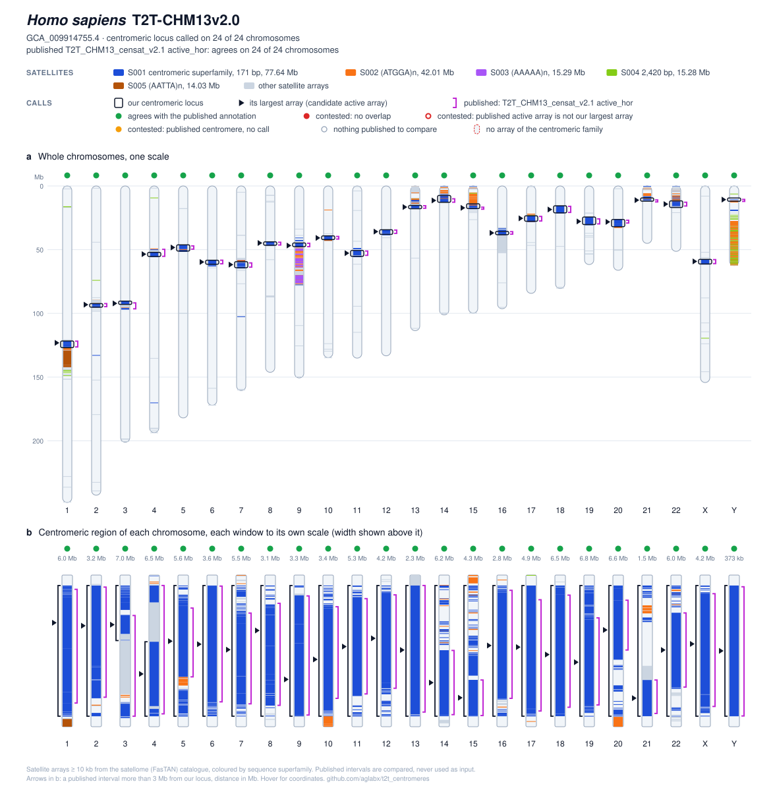

# t2t_centromeres

Centromeric satellite arrays, one locus per chromosome, for **32 telomere-to-telomere assemblies**:
human (CHM13), chimpanzee, bonobo, gorilla, Sumatran and Bornean orangutan, siamang, crab-eating and
rhesus macaque, pig, sheep, goat, horse and giraffe, including the alternate and parental haplotype
assemblies deposited for most of them.

The calls are made from [satellome](https://github.com/aglabx/satellome) (FasTAN engine) tandem-repeat
catalogues. Where the assembly's authors published a centromere annotation, it sits in the same GFF and
every chromosome says **where and how the two intersect**. Everything here is rebuilt from public
inputs by one script (`workflow/reproduce.sh`) and checked by md5 (`workflow/verify.sh`).

## What is in `annotations/<Organism>__<assembly>__<accession>/`

One directory per assembly, named so that it sorts by species, e.g.
`Homo_sapiens__T2T-CHM13v2.0__GCA_009914755.4`, `Pan_paniscus__NHGRI_mPanPan1-v2.0_mat__GCA_028858845.2`
(`workflow/asm_dir.sh ACC` prints the name).

| file | content |
|---|---|
| `karyotype.svg` | open in a browser. **a**: every chromosome to scale with its satellite arrays coloured by superfamily, our locus boxed, each published interval bracketed beside it, one dot per published set (overlap / no overlap / no call). **b**: the centromeric region of each chromosome close up, our locus and the published intervals side by side, one bracket per interval. Hover for coordinates |
| `centromeres.gff3` | our locus (`centromere`, source `satellome_cen`); its arrays (`satellite_DNA`, `largest=true` on the longest one, a size fact only); every published interval (source = publisher); every overlap between the two (`region`, source `intersection`). seqid = GenBank accession |
| `centromeres.tsv` | one row per chromosome: locus, family, bp, largest array, monomer / HOR period, monomer consensus, co-located families |
| `centromeric_arrays.tsv` / `.bed` | every array of every locus with FasTAN period, monomer and HOR period, monomer and HOR consensus, and how it joined the locus |
| `official_overlap.tsv` | chromosome × published set: relation, overlap bp, fractions, gap |
| `satellite_arrays.tsv` | every satellite array ≥ 10 kb on a chromosome with its superfamily and monomer / HOR period (what the karyotype draws) |
| `family_breadth.tsv` | every satellite superfamily: chromosomes carrying it (≥ 10 kb; and ≥ 100 kb), bp, base monomer period, chromosomes with it at both ends |
| `outliers.tsv` | chromosomes with no array of the centromeric family; arrays without a usable consensus |
| `exceptions.tsv` | near ties, broad short-consensus (not eligible) superfamilies, co-families, cap mode, skipped subterminal caps, terminal (acro/telocentric) loci, a second comparable locus |
| `MANIFEST.md5` | md5 of the above |

Panel tables: `annotations/SUMMARY.tsv`, `ALL_centromeres.tsv`, `ALL_official_overlap.tsv`, `STATUS.tsv`.
Every GFF attribute and relation is defined in [`docs/OUTPUT_FORMAT.md`](docs/OUTPUT_FORMAT.md).

**The locus is the centromeric satellite zone, not the centromere itself.** The functional centromere (the
active HOR in primates, the CENP-A domain) is usually a small part of that zone, and the size of an array
does not identify it: on the 15 ape chromosomes where CenSat placed the active array from CENP-A and CDR,
our locus overlaps it on 14, but the largest array of our locus covers at least half of it on only 6. No
array is put forward as the active one; the comparison with every published set is made at the level of
the locus.



## Results

<!-- BEGIN TABLES (generated by src/t2t_centromeres/readme_tables.py; do not edit) -->
| organism | assembly | accession | chromosomes with a call | centromeric family (monomer bp) | karyotype |
|---|---|---|---:|---|---|
| *Capra hircus* | [T2T-goat1.0](annotations/Capra_hircus__T2T-goat1.0__GCA_040806595.1) | GCA_040806595.1 | 30 / 31 | 703 + co-family | [svg](annotations/Capra_hircus__T2T-goat1.0__GCA_040806595.1/karyotype.svg) |
| *Capra hircus* | [T2T-goat1.0M](annotations/Capra_hircus__T2T-goat1.0M__GCA_041736475.1) | GCA_041736475.1 | 28 / 30 | 816 + co-family | [svg](annotations/Capra_hircus__T2T-goat1.0M__GCA_041736475.1/karyotype.svg) |
| *Capra hircus* | [T2T-goat1.0P](annotations/Capra_hircus__T2T-goat1.0P__GCA_041920685.1) | GCA_041920685.1 | 28 / 30 | 816 + co-family | [svg](annotations/Capra_hircus__T2T-goat1.0P__GCA_041920685.1/karyotype.svg) |
| *Capra hircus* | [T2T-goat2.0](annotations/Capra_hircus__T2T-goat2.0__GCA_041735815.1) | GCA_041735815.1 | 30 / 31 | 703 + co-family | [svg](annotations/Capra_hircus__T2T-goat2.0__GCA_041735815.1/karyotype.svg) |
| *Capra hircus* | [T2T-goat2.0M](annotations/Capra_hircus__T2T-goat2.0M__GCA_040970035.1) | GCA_040970035.1 | 28 / 30 | 816 + co-family | [svg](annotations/Capra_hircus__T2T-goat2.0M__GCA_040970035.1/karyotype.svg) |
| *Capra hircus* | [T2T-goat2.0P](annotations/Capra_hircus__T2T-goat2.0P__GCA_041053135.1) | GCA_041053135.1 | 28 / 30 | 816 + co-family | [svg](annotations/Capra_hircus__T2T-goat2.0P__GCA_041053135.1/karyotype.svg) |
| *Equus caballus* | [T2T-horse1.0](annotations/Equus_caballus__T2T-horse1.0__GCA_052818215.1) | GCA_052818215.1 | 32 / 33 | 221 | [svg](annotations/Equus_caballus__T2T-horse1.0__GCA_052818215.1/karyotype.svg) |
| *Giraffa tippelskirchi* | [T2T-mGirTip1v1.2.alt](annotations/Giraffa_tippelskirchi__T2T-mGirTip1v1.2.alt__GCA_054371575.1) | GCA_054371575.1 | 14 / 14 | 328 | [svg](annotations/Giraffa_tippelskirchi__T2T-mGirTip1v1.2.alt__GCA_054371575.1/karyotype.svg) |
| *Giraffa tippelskirchi* | [T2T-mGirTip1v1.2.mat](annotations/Giraffa_tippelskirchi__T2T-mGirTip1v1.2.mat__GCA_054371825.1) | GCA_054371825.1 | 15 / 15 | 328 | [svg](annotations/Giraffa_tippelskirchi__T2T-mGirTip1v1.2.mat__GCA_054371825.1/karyotype.svg) |
| *Giraffa tippelskirchi* | [T2T-mGirTip1v1.2.pat](annotations/Giraffa_tippelskirchi__T2T-mGirTip1v1.2.pat__GCA_054371615.1) | GCA_054371615.1 | 14 / 15 | 329 | [svg](annotations/Giraffa_tippelskirchi__T2T-mGirTip1v1.2.pat__GCA_054371615.1/karyotype.svg) |
| *Giraffa tippelskirchi* | [T2T-mGirTip1v1.2.pri](annotations/Giraffa_tippelskirchi__T2T-mGirTip1v1.2.pri__GCA_054371585.1) | GCA_054371585.1 | 15 / 16 | 328 | [svg](annotations/Giraffa_tippelskirchi__T2T-mGirTip1v1.2.pri__GCA_054371585.1/karyotype.svg) |
| *Gorilla gorilla gorilla* | [NHGRI_mGorGor1-v2.0_mat](annotations/Gorilla_gorilla_gorilla__NHGRI_mGorGor1-v2.0_mat__GCA_028885495.2) | GCA_028885495.2 | 24 / 24 | 171 | [svg](annotations/Gorilla_gorilla_gorilla__NHGRI_mGorGor1-v2.0_mat__GCA_028885495.2/karyotype.svg) |
| *Gorilla gorilla gorilla* | [NHGRI_mGorGor1-v2.0_pat](annotations/Gorilla_gorilla_gorilla__NHGRI_mGorGor1-v2.0_pat__GCA_028885475.2) | GCA_028885475.2 | 24 / 24 | 171 | [svg](annotations/Gorilla_gorilla_gorilla__NHGRI_mGorGor1-v2.0_pat__GCA_028885475.2/karyotype.svg) |
| *Gorilla gorilla gorilla* | [NHGRI_mGorGor1-v2.1_pri](annotations/Gorilla_gorilla_gorilla__NHGRI_mGorGor1-v2.1_pri__GCA_029281585.3) | GCA_029281585.3 | 25 / 25 | 171 | [svg](annotations/Gorilla_gorilla_gorilla__NHGRI_mGorGor1-v2.1_pri__GCA_029281585.3/karyotype.svg) |
| *Homo sapiens* | [T2T-CHM13v2.0](annotations/Homo_sapiens__T2T-CHM13v2.0__GCA_009914755.4) | GCA_009914755.4 | 24 / 24 | 171 | [svg](annotations/Homo_sapiens__T2T-CHM13v2.0__GCA_009914755.4/karyotype.svg) |
| *Macaca fascicularis* | [T2T-MFA8v1.1](annotations/Macaca_fascicularis__T2T-MFA8v1.1__GCA_037993035.2) | GCA_037993035.2 | 22 / 22 | 171 | [svg](annotations/Macaca_fascicularis__T2T-MFA8v1.1__GCA_037993035.2/karyotype.svg) |
| *Macaca mulatta* | [T2T-MMU8v2.0](annotations/Macaca_mulatta__T2T-MMU8v2.0__GCA_049350105.2) | GCA_049350105.2 | 22 / 22 | 171 | [svg](annotations/Macaca_mulatta__T2T-MMU8v2.0__GCA_049350105.2/karyotype.svg) |
| *Ovis aries* | [T2T-sheep1.0](annotations/Ovis_aries__T2T-sheep1.0__GCA_040805955.1) | GCA_040805955.1 | 28 / 28 | 816 | [svg](annotations/Ovis_aries__T2T-sheep1.0__GCA_040805955.1/karyotype.svg) |
| *Ovis aries* | [T2T-sheep1.0M](annotations/Ovis_aries__T2T-sheep1.0M__GCA_041121725.1) | GCA_041121725.1 | 25 / 27 | 816 | [svg](annotations/Ovis_aries__T2T-sheep1.0M__GCA_041121725.1/karyotype.svg) |
| *Ovis aries* | [T2T-sheep1.0P](annotations/Ovis_aries__T2T-sheep1.0P__GCA_040836155.1) | GCA_040836155.1 | 24 / 27 | 816 | [svg](annotations/Ovis_aries__T2T-sheep1.0P__GCA_040836155.1/karyotype.svg) |
| *Pan paniscus* | [NHGRI_mPanPan1-v2.0_mat](annotations/Pan_paniscus__NHGRI_mPanPan1-v2.0_mat__GCA_028858845.2) | GCA_028858845.2 | 24 / 24 | 171 | [svg](annotations/Pan_paniscus__NHGRI_mPanPan1-v2.0_mat__GCA_028858845.2/karyotype.svg) |
| *Pan paniscus* | [NHGRI_mPanPan1-v2.0_pat](annotations/Pan_paniscus__NHGRI_mPanPan1-v2.0_pat__GCA_028858825.2) | GCA_028858825.2 | 24 / 24 | 171 | [svg](annotations/Pan_paniscus__NHGRI_mPanPan1-v2.0_pat__GCA_028858825.2/karyotype.svg) |
| *Pan paniscus* | [NHGRI_mPanPan1-v2.1_pri](annotations/Pan_paniscus__NHGRI_mPanPan1-v2.1_pri__GCA_029289425.3) | GCA_029289425.3 | 25 / 25 | 171 | [svg](annotations/Pan_paniscus__NHGRI_mPanPan1-v2.1_pri__GCA_029289425.3/karyotype.svg) |
| *Pan troglodytes* | [NHGRI_mPanTro3-v2.0_alt](annotations/Pan_troglodytes__NHGRI_mPanTro3-v2.0_alt__GCA_028858805.2) | GCA_028858805.2 | 23 / 23 | 171 | [svg](annotations/Pan_troglodytes__NHGRI_mPanTro3-v2.0_alt__GCA_028858805.2/karyotype.svg) |
| *Pan troglodytes* | [NHGRI_mPanTro3-v2.1_pri](annotations/Pan_troglodytes__NHGRI_mPanTro3-v2.1_pri__GCA_028858775.3) | GCA_028858775.3 | 25 / 25 | 171 | [svg](annotations/Pan_troglodytes__NHGRI_mPanTro3-v2.1_pri__GCA_028858775.3/karyotype.svg) |
| *Pongo abelii* | [NHGRI_mPonAbe1-v2.0_alt](annotations/Pongo_abelii__NHGRI_mPonAbe1-v2.0_alt__GCA_028885685.2) | GCA_028885685.2 | 23 / 23 | 171 | [svg](annotations/Pongo_abelii__NHGRI_mPonAbe1-v2.0_alt__GCA_028885685.2/karyotype.svg) |
| *Pongo abelii* | [NHGRI_mPonAbe1-v2.1_pri](annotations/Pongo_abelii__NHGRI_mPonAbe1-v2.1_pri__GCA_028885655.3) | GCA_028885655.3 | 25 / 25 | 171 | [svg](annotations/Pongo_abelii__NHGRI_mPonAbe1-v2.1_pri__GCA_028885655.3/karyotype.svg) |
| *Pongo pygmaeus* | [NHGRI_mPonPyg2-v2.0_alt](annotations/Pongo_pygmaeus__NHGRI_mPonPyg2-v2.0_alt__GCA_028885525.2) | GCA_028885525.2 | 23 / 23 | 171 | [svg](annotations/Pongo_pygmaeus__NHGRI_mPonPyg2-v2.0_alt__GCA_028885525.2/karyotype.svg) |
| *Pongo pygmaeus* | [NHGRI_mPonPyg2-v2.1_pri](annotations/Pongo_pygmaeus__NHGRI_mPonPyg2-v2.1_pri__GCA_028885625.3) | GCA_028885625.3 | 25 / 25 | 171 | [svg](annotations/Pongo_pygmaeus__NHGRI_mPonPyg2-v2.1_pri__GCA_028885625.3/karyotype.svg) |
| *Sus scrofa* | [T2T-Sscrofa](annotations/Sus_scrofa__T2T-Sscrofa__GCA_000003025.7) | GCA_000003025.7 | 19 / 20 | 336 | [svg](annotations/Sus_scrofa__T2T-Sscrofa__GCA_000003025.7/karyotype.svg) |
| *Symphalangus syndactylus* | [NHGRI_mSymSyn1-v2.0_alt](annotations/Symphalangus_syndactylus__NHGRI_mSymSyn1-v2.0_alt__GCA_028878085.3) | GCA_028878085.3 | 24 / 24 | 171 | [svg](annotations/Symphalangus_syndactylus__NHGRI_mSymSyn1-v2.0_alt__GCA_028878085.3/karyotype.svg) |
| *Symphalangus syndactylus* | [NHGRI_mSymSyn1-v2.1_pri](annotations/Symphalangus_syndactylus__NHGRI_mSymSyn1-v2.1_pri__GCA_028878055.3) | GCA_028878055.3 | 26 / 26 | 171 | [svg](annotations/Symphalangus_syndactylus__NHGRI_mSymSyn1-v2.1_pri__GCA_028878055.3/karyotype.svg) |

| assembly | published set | chromosomes compared | agrees | contested: no overlap | contested: no call |
|---|---|---:|---:|---:|---:|
| T2T-CHM13v2.0 | T2T_CHM13_censat_v2.1 (active_hor) | 24 | 24 | 0 | 0 |
| NHGRI_mPanTro3-v2.1_pri | T2T_primates_CenSat_v2.0 (active_hor) | 25 | 25 | 0 | 0 |
| NHGRI_mPanTro3-v2.0_alt | T2T_primates_CenSat_v2.0 (active_hor) | 23 | 22 | 1 | 0 |
| NHGRI_mPanPan1-v2.0_pat | T2T_primates_CenSat_v2.0 (active_hor) | 24 | 24 | 0 | 0 |
| NHGRI_mPanPan1-v2.0_mat | T2T_primates_CenSat_v2.0 (active_hor) | 24 | 23 | 1 | 0 |
| NHGRI_mSymSyn1-v2.1_pri | T2T_primates_CenSat_v2.0 (active_hor) | 26 | 23 | 3 | 0 |
| NHGRI_mSymSyn1-v2.0_alt | T2T_primates_CenSat_v2.0 (active_hor) | 24 | 21 | 3 | 0 |
| NHGRI_mGorGor1-v2.0_pat | T2T_primates_CenSat_v2.0 (active_hor) | 24 | 24 | 0 | 0 |
| NHGRI_mGorGor1-v2.0_mat | T2T_primates_CenSat_v2.0 (active_hor) | 24 | 24 | 0 | 0 |
| NHGRI_mPonPyg2-v2.0_alt | T2T_primates_CenSat_v2.0 (active_hor) | 23 | 23 | 0 | 0 |
| NHGRI_mPonPyg2-v2.1_pri | T2T_primates_CenSat_v2.0 (active_hor) | 25 | 25 | 0 | 0 |
| NHGRI_mPonAbe1-v2.1_pri | T2T_primates_CenSat_v2.0 (active_hor) | 24 | 24 | 0 | 0 |
| NHGRI_mPonAbe1-v2.0_alt | T2T_primates_CenSat_v2.0 (active_hor) | 22 | 22 | 0 | 0 |
| NHGRI_mGorGor1-v2.1_pri | T2T_primates_CenSat_v2.0 (active_hor) | 25 | 25 | 0 | 0 |
| NHGRI_mPanPan1-v2.1_pri | T2T_primates_CenSat_v2.0 (active_hor) | 25 | 24 | 1 | 0 |
| T2T-MFA8v1.1 | T2T-MFA8_Nature2025_S39 (presumed_active_array) | 21 | 21 | 0 | 0 |
| T2T-MFA8v1.1 | T2T-MFA8_release_v1.1 (centromere_region) | 22 | 22 | 0 | 0 |
| T2T-sheep1.0 | T2T-sheep_NatGenet2025_S8 (gene_in_centromeric_region) | 25 | 16 | 9 | 0 |
| T2T-MMU8v2.0 | T2T-MMU8_release_v2.0 (alpha_satellite_region) | 22 | 22 | 0 | 0 |

**Contested** — every chromosome where our call contradicts a published annotation (`agreement` in `official_overlap.tsv`, `published_agreement=contested` in the GFF):

- T2T-sheep1.0 vs T2T-sheep_NatGenet2025_S8, no overlap: 5, 7, 14, 16, 19, 21, 22, 24, X
- NHGRI_mPanPan1-v2.0_mat vs T2T_primates_CenSat_v2.0, no overlap: chr17_mat_hsa18
- NHGRI_mPanPan1-v2.1_pri vs T2T_primates_CenSat_v2.0, no overlap: chr17_mat_hsa18
- NHGRI_mPanTro3-v2.0_alt vs T2T_primates_CenSat_v2.0, no overlap: chr6_hap2_hsa7
- NHGRI_mSymSyn1-v2.0_alt vs T2T_primates_CenSat_v2.0, no overlap: chr19_hap2 (molecule 12), chr15_hap2, chr21_hap2
- NHGRI_mSymSyn1-v2.1_pri vs T2T_primates_CenSat_v2.0, no overlap: chr19_hap1 (molecule 12), chr21_hap1, chrY_hap2
<!-- END TABLES -->

### What the comparison shows

Where our call contradicts a published annotation it is labelled **contested**, never left for the reader to
find: the `agreement` column of `official_overlap.tsv`, `published_agreement=contested` with a `Note` in the
GFF, a red mark in the karyotype, and the generated list above. Two kinds: our locus does not overlap the
published interval; the authors place a centromere where we make no call.

- **CHM13, the one independent test.** Our locus overlaps the live HOR of the T2T Consortium censat v2.1
  on 24 of 24 chromosomes. Taking the largest array of each chromosome
  instead lands on the live HOR on 16 of 24 (HSat1/2/3 arrays are larger on 8).
- **Sheep, indirect.** The authors published genes in their centromeric regions, not the regions. Our
  locus overlaps the span of those genes on 16 of 25 chromosomes. chrX is the clear miss: the only large
  satellite array beside the authors' genes (0.65–7.2 Mb) is a 1.1-Mb SatII (702 bp) array at 7.22–8.35 Mb.
  SatII is on 14 of the 28 sheep chromosomes, too few to join as a co-family, so the call is a 22-kb SatI
  period-class array at 91.9 Mb, flagged `other_family_larger_on_chromosome`.
- **Apes and siamang.** CenSat `active_hor` is the longest high-confidence (SF1–SF3) alpha-satellite HOR
  array of the chromosome (the rule since CenSat v0.1), except on 15 contigs where the authors set the active
  array by hand from CENP-A localisation and the CDR ([T2TPrimates README](https://github.com/hloucks/CenSatData/blob/main/T2TPrimates/README.md),
  [`Primate_alpha_summary.sh`](https://github.com/hloucks/CenSatData/blob/main/T2TPrimates/Code/Primate_alpha_summary.sh)).
  Agreement of our locus with a size-defined label is consistency rather than validation; a contested
  chromosome is a disagreement, not proof that either annotation is wrong.
- **Macaques.** The published intervals are defined from sequence (presumed-active arrays, alpha-satellite
  spans, RepeatMasker), so agreement is consistency rather than validation.
- **Chromosomes without a call** (`outliers.tsv`): chrY of pig, goats and giraffe, and horse Chr11, which
  the T2T-horse authors describe as satellite-free. On the haplotype assemblies of goat (chr9 and chr21
  maternal, chr28 paternal) and sheep (chr7 and chr14, plus chr15 paternal) the chromosome is 2.4–20.8 Mb
  shorter than the same chromosome in the other assemblies of that individual and carries no array of the
  centromeric family: the satellite block is absent from that assembly.
- **Reproducibility.** Two runs of the caller on the same catalogues gave byte-identical files on all 17
  assemblies compared. The NCBI-download route of `reproduce.sh` gave a satellome catalogue byte-identical
  to our local run (tested on GCA_048601705.1, the smoke-test fixture).

## How a centromere is called

1. **Arrays ≥ 10 kb** from the FasTAN BED, with the arraysplitter monomer / HOR period and consensus.
2. **Sequence families** — monomer consensus searched against doubled and reverse-complement-doubled
   copies of every other consensus (rotation- and strand-aware), BLASTN, single linkage at ≥ 0.70 identity
   over ≥ 0.80 of the query.
3. **Superfamilies** — a family joins the largest family (the founder) whose base monomer period is
   equal to or 2× its own (alpha 169 / 171 / 340 join; a 32-bp subterminal satellite does not). Families
   are compared with the founder only, never member to member, so periods cannot drift along a chain.
4. **The centromeric superfamily** is the one present (one array ≥ 10 kb) on the most chromosomes —
   breadth, not size: the largest array of a chromosome is HSat1/2/3 rather than alpha on 8 of 24 CHM13
   chromosomes. Superfamilies without a consensus ≥ 30 bp (microsatellites, the telomeric repeat) are not
   eligible. Broad superfamilies co-located with it (bovid SatI + SatII) join as co-families.
5. **Per chromosome** its arrays, plus arrays of the same monomer-period class, are merged across gaps
   < 1 Mb; the cluster with the most bp is the locus. If the superfamily also caps both chromosome ends on
   most chromosomes (siamang), an interior cluster is preferred.

Every choice and the measurement behind it: [`docs/PARAMETERS.md`](docs/PARAMETERS.md).

## Published annotations used for comparison

They are compared, never used as input. Only some of them rest on evidence other than the sequence itself:

| assemblies | published set | definition | independent? |
|---|---|---|---|
| CHM13 | T2T Consortium censat v2.1, live HOR `hor_*(…L)` | CENP-A / CDR-informed | yes |
| chimpanzee, bonobo, gorilla, orangutans | T2T Primates CenSat v2.0 `active_hor` | longest high-confidence HOR array of the chromosome; set from CENP-A and CDR on 14 contigs (bonobo 9, Sumatran orangutan 3, Bornean orangutan 2) | mostly no |
| siamang | T2T Primates CenSat v2.0 `active_hor` (joined by accession via the marbl/T2T-Browser alias table) | longest high-confidence HOR array; chrY_hap2 set from CENP-A and CDR | mostly no |
| T2T-MFA8 | Supp. Table 39 presumed-active S1S2 arrays; release `centromere.bed` | sequence only | no |
| T2T-MMU8 | release `alpha_satellite.bed` (RepeatMasker) | sequence only | no |
| T2T-sheep1.0 | Supp. Table 8, genes in the authors' centromeric regions | CENP-A ChIP + methylation + satellite | yes, indirectly |
| goats, pig, horse, giraffe | — no interval file published | | |

URLs and md5 of every file: [`config/official_downloads.tsv`](config/official_downloads.tsv). The public CenSat
v2.0 files include chrY of the assemblies that carry it (gorilla and bonobo primary and paternal; chimpanzee,
orangutan and siamang primary), and those 8 are compared; ape chrY tracks from other sources are not used.
Note for siamang: the NCBI assembly report keeps pre-v2.1 chromosome labels (`chr19_hap1` is molecule 12);
join on accession or molecule, never on that name.

## Reproduce

```bash
export PYTHONNOUSERSITE=1                # else pip skips packages it finds in ~/.local (arraysplitter's binary goes missing)
conda env create -f environment.yml && conda activate t2t_centromeres   # mamba env create: 1.5 min vs > 12 min
python -m satellome --install-fastan --install-tanbed --install-rust-tools
bash workflow/check_env.sh               # versions vs config/toolchain.tsv
bash tests/smoke_test.sh work_smoke/      # ~3 min: the 17-Mb MFA8 chrY accession end to end, md5 vs tests/expected/
bash workflow/reproduce.sh work/ 5 10    # all 32: 5 assemblies at a time, 10 threads each
```

`reproduce.sh` downloads each GenBank assembly from NCBI (md5-checked), runs satellome
(`workflow/run_satellome.sh`), fetches the published annotations (md5-checked, refuses on mismatch), calls
the centromeres (`workflow/call_all.sh`) and compares the result with `annotations/` file by file
(`workflow/verify.sh`). satellome took 15–71 min wall per assembly (median 36) at 10 threads, five assemblies
at a time (logs of the 32 release runs; Ubuntu 22.04, 192 cores shared with other jobs); most of it is the
monomer decomposition (median 64 % of a run), peak memory at most 4.04 GB. Calling all 32 takes 57 min at
16 threads. Tested on Linux only.

Toolchain the annotations were produced with: satellome 1.17.2, FasTAN 0.8 (ad3002/FASTAN e4953e9),
tanbed (richarddurbin/alntools 1fb9f4f), arraysplitter 1.7.4, BLAST+ 2.12.0, Python 3.10
([`config/toolchain.tsv`](config/toolchain.tsv)).

## Changes in v1.2

- **32 assemblies, not 33.** GCA_048601705.1 (T2T-MFA8v1.1 chrY deposited on its own) is the same GenBank
  sequence (CP168063.1, 17,124,583 bp) as chrY of GCA_037993035.2, which the panel already contains; v1.1
  counted that chromosome twice. It stays only as the input of `tests/smoke_test.sh` (expected md5 in
  `tests/expected/`).
- **The verdict is about the locus only.** v1.1 put the largest array of our locus forward as the candidate
  active array and labelled `contested_active_array` where a published active array was another array of the
  locus. The size of an array does not identify the active array, so that label and the candidate are gone;
  `largest_array_overlap_bp` stays in `official_overlap.tsv` as a descriptive column. The 18 such v1.1 rows
  now read `agrees` (our locus overlaps the published interval).
- **Karyotype figure.** Each published interval is its own bracket (v1.1 drew one bracket from the first to
  the last interval of a set, which on CHM13 chr3 and chr4 spanned a 42-bp satellite array between pieces of
  the live HOR); other satellite arrays are a darker grey, so an array never reads as empty sequence; no
  array is marked as the largest.
- **CenSat definition corrected.** The ape `active_hor` is the longest high-confidence HOR array of the
  chromosome, with the active array set from CENP-A and CDR on 15 contigs; v1.1 cited the CenSatData root
  README, which does not state the rule, and left out the curated contigs.
- The calls themselves (`centromeres.tsv`, arrays, families, outliers, exceptions) are byte-identical to v1.1.

## Sources

Assemblies: NCBI GenBank, accessions in [`config/assemblies.tsv`](config/assemblies.tsv). Papers whose
centromere annotations are compared (DOIs):
T2T apes — Yoo et al., *Nature* 2025, 10.1038/s41586-025-08816-3;
T2T-MFA8 — Zhang et al., *Nature* 2025, 10.1038/s41586-025-08596-w;
T2T-MMU8 — Zhang et al., *Cell* 2026, 10.1016/j.cell.2026.02.018;
T2T-sheep — Luo et al., *Nature Genetics* 2025, 10.1038/s41588-024-02037-6.
Assemblies without a published centromere interval file: T2T-goat (Wu et al., *Nature Communications*
2024, 10.1038/s41467-024-54188-z), T2T-Sscrofa (bioRxiv 10.1101/2025.10.02.679976), T2T-horse1.0
(bioRxiv 10.1101/2025.09.10.675315), T2T giraffe (*Cell Genomics* 2026, 10.1016/j.xgen.2026.101279).

## Licence

Code: MIT ([`LICENSE`](LICENSE)). Our annotations: CC BY 4.0; published intervals in the GFF remain their
authors' ([`annotations/LICENSE.md`](annotations/LICENSE.md)).
